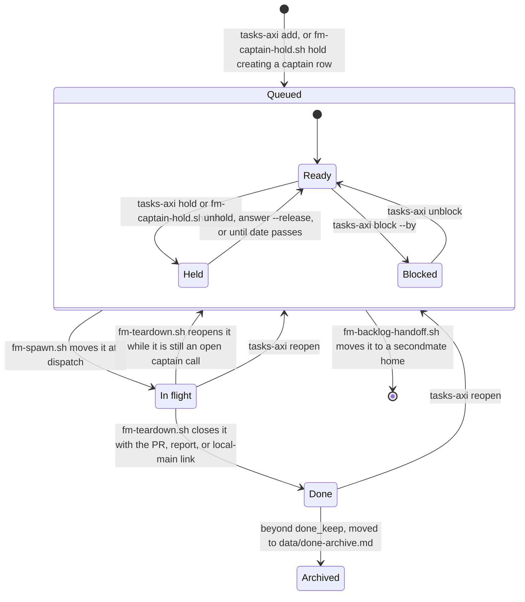
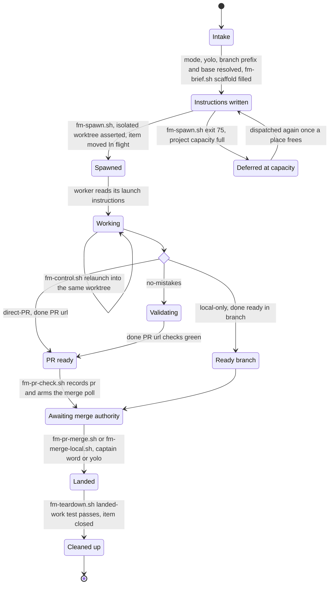
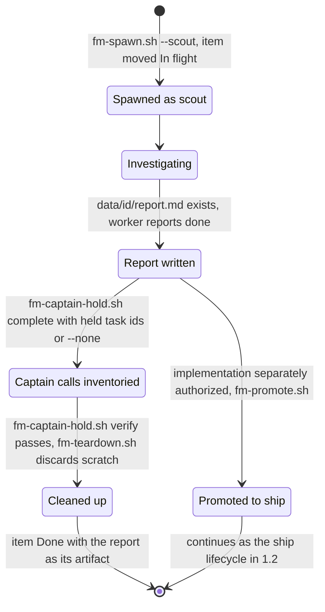
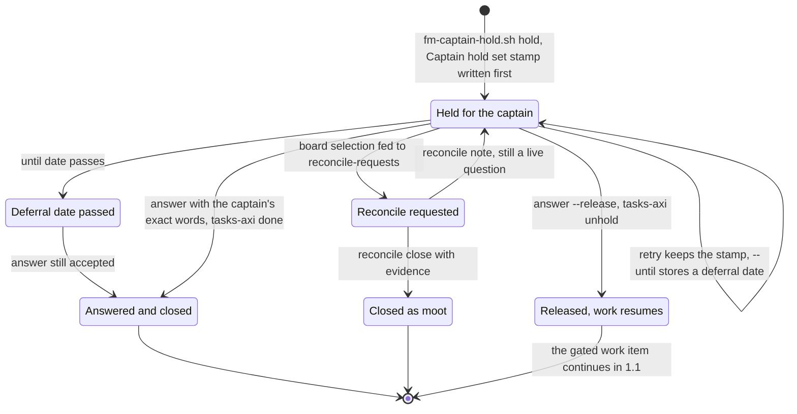
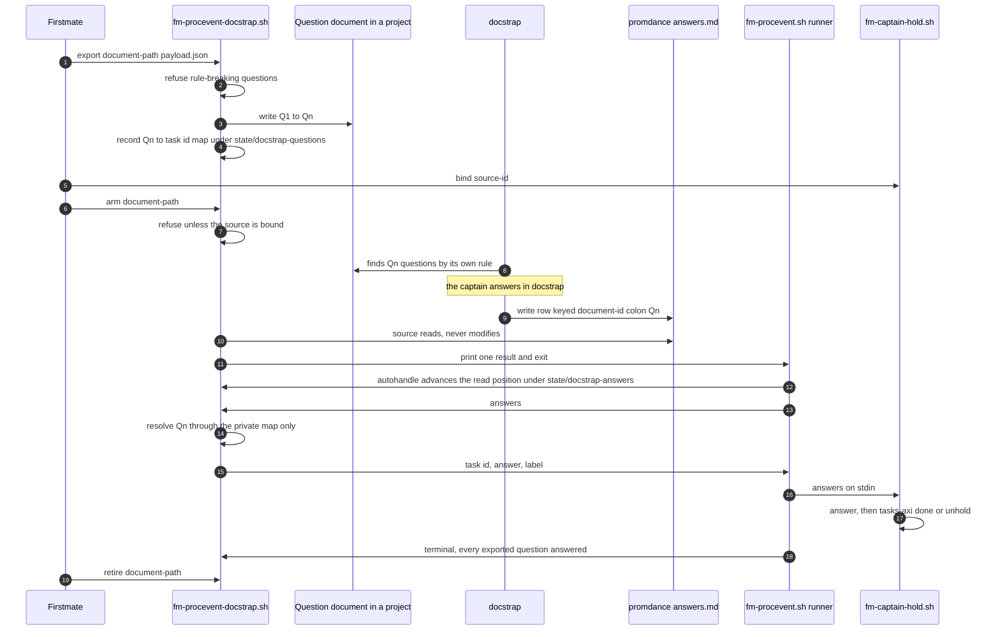
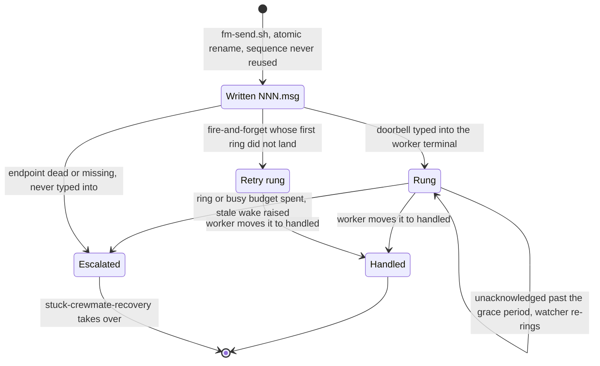
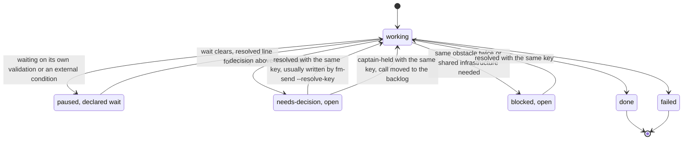
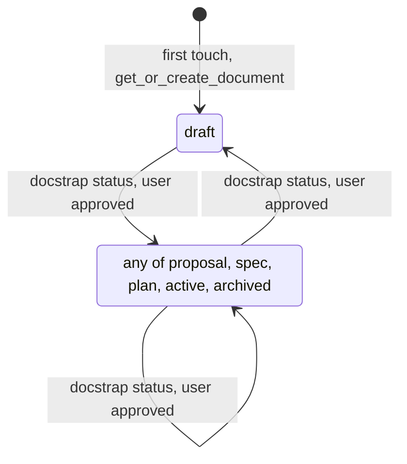
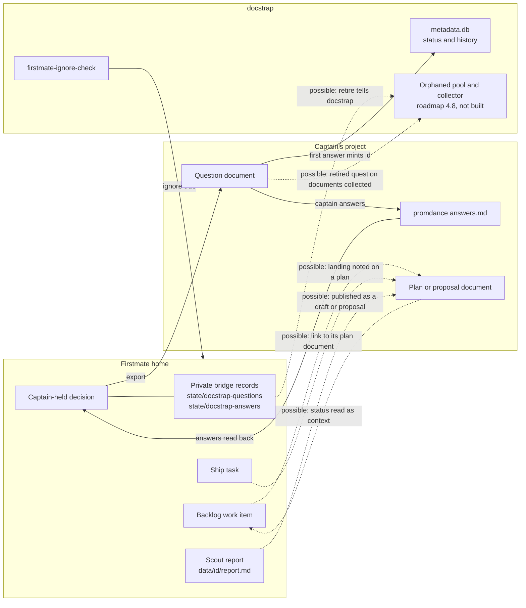
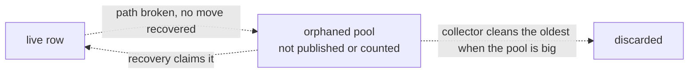

# Firstmate lifecycles, and how they could relate to docstrap

This note draws the lifecycles of firstmate's main things as mermaid diagrams.
Part 1 is current behavior, derived from the owning scripts, skills, and docs named beside each diagram.
Part 2 is about docstrap: what docstrap has today, the one bridge that already exists, and relations that are only possible.
Nothing in Part 2 marked possible exists today, in either repository.

Each diagram is a reading aid, not a second owner.
When a diagram and its owning file disagree, the owning file is right and the diagram is stale.

## Contents

1. [Part 1 - Firstmate lifecycles today](#part-1---firstmate-lifecycles-today)
   1. [Backlog work item](#11-backlog-work-item)
   2. [Ship task, from instructions to landing and cleanup](#12-ship-task-from-instructions-to-landing-and-cleanup)
   3. [Scout task, to its report](#13-scout-task-to-its-report)
   4. [Captain-held decision](#14-captain-held-decision)
   5. [Docstrap question bridge round trip](#15-docstrap-question-bridge-round-trip)
   6. [Worker steering inbox](#16-worker-steering-inbox)
   7. [Worker status events](#17-worker-status-events)
2. [Part 2 - How each could relate to docstrap](#part-2---how-each-could-relate-to-docstrap)
   1. [What docstrap has today](#21-what-docstrap-has-today)
   2. [Relation map](#22-relation-map)
   3. [Relation by relation](#23-relation-by-relation)
   4. [The garbage collector](#24-the-garbage-collector)
   5. [Commands to manage the firstmate section](#25-commands-to-manage-the-firstmate-section)

## Part 1 - Firstmate lifecycles today

### 1.1 Backlog work item

Owners: `bin/fm-tasks-axi.sh` (header), `tasks-axi --help`, `docs/configuration.md` "Backlog backend", `bin/fm-backlog-transition-lib.sh`, and `bin/fm-captain-hold.sh` for captain holds.

A row lives in one of three sections: Queued, In flight, Done.
Held and blocked are flags on a row, not sections.
A hold carries a kind (`captain`, `external`, `load`, `parked`, `future`) and an optional `--until` date after which it is inactive.
A block names the item it waits on with `--by`.
Dispatch accepts only an unheld, unblocked Queued or In flight item, which is why the flags are drawn inside Queued.
A hold can also sit on an In flight item; cleanup then reopens the row instead of closing it, as shown.

`bin/fm-tasks-axi.sh` refuses `add --start`, so no row reaches In flight without the task record, status file, and inbox that `bin/fm-spawn.sh` creates.
A spawn beyond `config/project-capacity` exits 75 and leaves the item Queued rather than blocked.
A handoff moves only Queued items; In flight and Done stay with their home.
A captain call is not a separate record: it is this same row, held with kind `captain` (section 1.4).

### 1.2 Ship task, from instructions to landing and cleanup

Owners: `AGENTS.md` section 7, `bin/fm-brief.sh`, `bin/fm-spawn.sh` (header), `.agents/skills/ship-landing/SKILL.md`, `bin/fm-pr-check.sh`, `bin/fm-pr-merge.sh`, `bin/fm-merge-local.sh`, and `bin/fm-teardown.sh` (header).

The delivery mode is chosen at intake and fixes the path from working to ready.
Merge authority is separate from the mode: the captain's explicit word, or a project's standing `yolo` posture for green in-scope work.

Cleanup refuses work that has not landed, including any uncommitted change, and never bypasses that without explicit discard authority.
A ready signal whose named head exists only in the worker's disposable copy is not ready (`bin/fm-dod-lib.sh`).
Decisions and blockers raised while working are status events (section 1.7), not states of this diagram.

### 1.3 Scout task, to its report

Owners: `bin/fm-spawn.sh --scout`, `.agents/skills/scout-completion/SKILL.md`, `bin/fm-captain-hold.sh` (`complete`, `verify`), `bin/fm-teardown.sh`, and `bin/fm-promote.sh`.

A scout's work product is `data/<id>/report.md`, never a PR.
Its worktree is declared scratch.

A report may recommend implementation but never authorizes it.
Any captain call the scout surfaced is held as its own backlog row (section 1.4) before cleanup, and cleanup never closes it.

### 1.4 Captain-held decision

Owners: `bin/fm-captain-hold.sh` (header), `docs/captain-hold-lifecycle.md`, and `.agents/skills/captain-hold-lifecycle/SKILL.md` for policy.

A decision is an ordinary backlog task held for the captain; its task id is its only identity.

Only `answer` with the captain's words, or an evidence-backed `reconcile close`, resolves a call.
The keyed-answer intake (`fm-captain-hold.sh answers`) routes every channel's answers through that same `answer` path and refuses reconcile values.
Cleanup of the originating task never closes the call; `bin/fm-teardown.sh` reopens the row instead.

### 1.5 Docstrap question bridge round trip

Owners: `bin/fm-procevent-docstrap.sh` (header), `.agents/skills/process-event-sources/SKILL.md`, `bin/fm-procevent.sh`, and `bin/fm-captain-hold.sh` (`bind`, `answers`).

Traffic is one way by design.
Firstmate writes a question document into one of the captain's project repositories and reads answers out of the store docstrap already writes.
Nothing asks docstrap to look at a firstmate home, and nothing changes docstrap.

The key is never read out of the document or the store, so edited prose cannot name a task.
A re-export that changes the label mapping re-baselines the read position, because `Q<n>` is a position, not an identity.
A replaced or truncated store reads as `continuity-broken` and delivers nothing.
`retire` drops firstmate's private records; the question document and its answer rows stay in the project.

### 1.6 Worker steering inbox

Owners: `bin/fm-task-inbox-lib.sh` (header), `bin/fm-send.sh` (header), `bin/fm-watch.sh`, and the worker side in `bin/fm-brief.sh`.

The message is a durable file; the terminal only receives a constant doorbell line.

The move into `handled/` is the acknowledgement.
A fire-and-forget record gets one retry ring at most and never escalates.

### 1.7 Worker status events

Owners: `bin/fm-brief.sh` (status protocol), `bin/fm-classify-lib.sh` (keyed open and resolved semantics), and `bin/fm-crew-state.sh` (current state).

A status line is a wake event appended to `state/<id>.status`, not current-state truth.
`bin/fm-crew-state.sh` owns reconciling current state.

An opened decision or blocker stays open until a `resolved` or `captain-held` line carrying its exact key lands.
A later `working` or `done` line never closes it.
`captain-held` closes the status copy without claiming the captain answered; the call itself continues in section 1.4.

## Part 2 - How each could relate to docstrap

### 2.1 What docstrap has today

Source: `~/platformshoes/packages/docstrap`, read as it stood on 2026-10-12.

Document status is a closed set of six values: `draft`, `proposal`, `spec`, `plan`, `active`, `archived` (`src/docstrap/metadata.py`).
There is no transition graph: any status may be set from any other, a new row defaults to `draft`, and every change appends to `status_history`.
`docstrap status <path> [STATUS]` is the change command, and the `docstrap-lifecycle` skill allows a change only when the user asked for that exact document and that exact from-to transition.
Metadata lives in SQLite at `~/.local/share/docstrap/metadata.db`; document ids are ULIDs minted on first touch.

Questions are blocks opening with a `Q<n>` label, or a `docstrap-questions` directive with a `:question-id:`.
Answers go to one store per project, `<project-promdance>/answers.md`, keyed `<document-id>:<label>`, with superseded answers in `answers-history.md`.
`docstrap questions [PATH]` lists the questions a document asks.

There is no garbage collector.
`docs/roadmap.md` section 4.8 designs an orphaned pool with a collector, and section 2.4 below describes it; none of it is built, and it waits on the schema upgrade path in `docs/proposals/0002-the-upgrade-path.md`.

Docstrap already knows about firstmate homes in one way: `docstrap firstmate-ignore-check` and `docstrap doctor` detect a firstmate operational home by shape and offer to write `ignore: true` into its `.docstrap`, so docstrap does not index it.

### 2.2 Relation map

Solid arrows exist today.
Dotted arrows are possible relations only.

### 2.3 Relation by relation

#### 2.3.1 Backlog work item

Today: no relation.
Possible: a backlog item could carry the path of the plan document it came from, and firstmate could read that document's docstrap status as context.
Docstrap's research note on the proposal-to-plan-to-work-item pipeline is vocabulary only, so nothing enforces that a plan precedes a work item.
Firstmate changing a document's status itself would conflict with the `docstrap-lifecycle` skill's per-change approval rule, so any write in this direction would at most propose a transition for the captain to approve.

#### 2.3.2 Ship task

Today: no relation.
Possible: a landing could be recorded beside the plan document that motivated it, as a link from that document rather than an edit to it, since docstrap never writes into a content file.

#### 2.3.3 Scout report

Today: no relation, and deliberately so: the report lives in a firstmate home, which `docstrap firstmate-ignore-check` keeps out of docstrap's index.
Possible: a report could be copied into a project as a document that starts as `draft` or `proposal`, after which its lifecycle is docstrap's, not firstmate's.

#### 2.3.4 Captain-held decision

Today: the bridge in section 1.5 is the one real relation, and it runs one way.
The question's identity on the firstmate side is the task id; on the docstrap side it is `<document-id>:<label>`; only firstmate's private map joins them.
Possible: `fm-ref:` context lines that the export already writes could be turned into links by docstrap's build; `docs/configuration.md` "docstrap question references" says nothing consumes them today.

#### 2.3.5 Steering inbox and status events

Today: no relation.
These are runtime records inside a firstmate home and have no document lifecycle, so no docstrap relation is suggested here.

### 2.4 The garbage collector

The captain asked that docstrap tie into docstrap's garbage collector.
The collector does not exist yet, so everything in this section is a possible relation.

The roadmap design has three states for a metadata row, and a row becomes orphaned when its `current_path` breaks with no recoverable move.

The roadmap's collector concerns metadata rows only; it does not mention answers or deleted documents.
The firstmate side has a natural point to meet it: when `retire` ends a question source, the question document and its answer rows outlive firstmate's private records.
Possible relations, none built:

1. A retired question document that the captain later deletes would become an orphaned metadata row, which the collector would then handle like any other.
2. Answer rows whose question document is gone are what docstrap already calls stale answers; nothing collects them today, and a collector could.
3. `retire` could leave a durable marker that the document's questions are finished, which the collector could read as a signal; this would be a new write into the project and needs the captain's word before anything is designed.

### 2.5 Commands to manage the firstmate section

The captain wrote that commands to manage the firstmate section would be useful.
Docstrap has no concept of a document section owned by an external tool, and its CLI has one command group, `stores`.
The commands that manage firstmate's part of the bridge today are firstmate's own: `bin/fm-procevent-docstrap.sh export`, `arm`, `read`, and `retire`, plus `bin/fm-captain-hold.sh bind` and `unbind`.
Which side should own new commands, and what "the firstmate section" should mean, are open and are not decided here.
